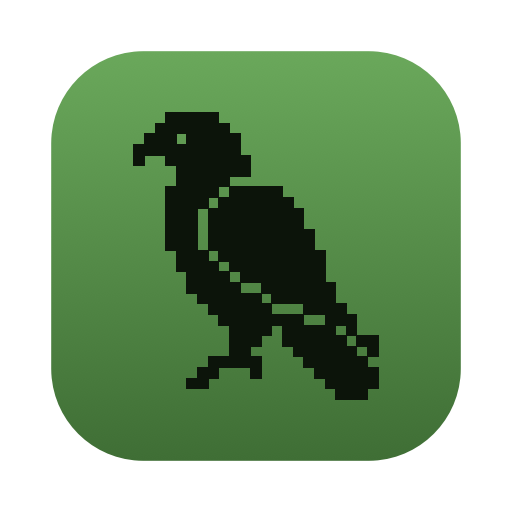

<p align="center">
  
</p>

<h1 align="center">Agent2</h1>
<p align="center"><b>The middleman for your AI agents.</b><br/>
A macOS menu-bar app that gets Claude Code, Codex, Gemini and your API keys working together. Hold <kbd>⌃ Control</kbd> + <kbd>⌥ Option</kbd> and talk.</p>

<p align="center">
  <a href="https://agent2.shakatec.co.za">Website</a> ·
  <a href="https://github.com/sekophungula/agent2/releases/latest/download/Agent2-macOS.zip">Download</a>
</p>

---

Agent2 doesn't do the heavy lifting itself. You pick one agent as the **source** (the brain). Agent2 tells it which other agents and tools are on your Mac, runs whatever it delegates **in parallel**, feeds the results back, and saves the whole conversation as **Markdown that you own**.

## Features

- **Menu bar, not the notch.** A pixel bird in the menu bar. Click it, or hold ⌃⌥ anywhere.
- **Push-to-talk.** Hold Control + Option, speak, let go. Transcribed on-device with Apple Speech. A quick tap opens the chat for typing.
- **Finds your agents.** Detects Claude Code, Codex CLI, Gemini CLI, Cursor Agent and OpenCode on your PATH, Anthropic/OpenAI API keys, and the Claude and ChatGPT desktop apps.
- **Real delegation.** The source writes `<delegate agent="codex">…</delegate>` (CLI agents) or calls a `delegate` tool (API agents). Agent2 runs those agents in parallel and returns the results.
- **History you own.** One Markdown file per conversation in `~/Agent2/History/YYYY-MM/`. It isn't stored in any one agent, so switching from Claude Code to Codex, or between sessions, keeps your context.
- **Detached.** Agent2 never switches the source by itself. You change it in Settings or from the menu.
- **Composio built in.** Link Gmail, Slack, GitHub, Notion, Linear, X, LinkedIn, Instagram, Calendar and more through the Composio CLI. If Composio is already set up in Claude Code or Codex, Agent2 detects it. One button adds it to your agents.
- **Your keys stay local.** Subscriptions go through each vendor's own CLI. API keys live in the macOS Keychain. No Agent2 servers.

## Install

1. Download `Agent2-macOS.zip` from [Releases](https://github.com/sekophungula/agent2/releases/latest) and move `Agent2.app` to Applications.
2. The build is ad-hoc signed, so the first time, right-click → **Open** → **Open**.
3. Grant **Accessibility** (for the ⌃⌥ shortcut), **Microphone** and **Speech Recognition** when asked.
4. Have at least one agent ready:
   - Claude Code: `npm i -g @anthropic-ai/claude-code`, then run `claude` once and sign in
   - Codex: `npm i -g @openai/codex`, then run `codex` once and sign in with ChatGPT
   - or add an Anthropic / OpenAI API key in Settings → Agents
5. Optional: install the [Composio CLI](https://docs.composio.dev/docs/cli), then use Settings → Apps to link your accounts.

## Build from source

Requires macOS 14+ and Xcode 16+ (Swift 5.10+).

```bash
./scripts/build-app.sh          # → dist/Agent2.app and dist/Agent2-macOS.zip
open dist/Agent2.app
```

Dev helpers:

```bash
cd app && swift build
.build/debug/Agent2 --ask "summarise my week"     # one request through the orchestrator, headless
.build/debug/Agent2 --snapshot /tmp/agent2-shots  # render the UI to PNGs
.build/debug/Agent2 --export-assets /tmp/assets   # icon set + logo SVGs from the pixel grid
```

## How it works

```
 you (voice / text)
        │
        ▼
 ┌──────────────┐   system prompt: available agents, workspace, history folder, Composio
 │ source agent │ ───────────────────────────────────────────────────────────────────┐
 └──────┬───────┘                                                                    │
        │ <delegate agent="codex">brief</delegate>   (or the delegate tool for APIs) │
        ▼                                                                            │
 ┌────────────┐  ┌────────────┐  ┌────────────┐   run in parallel, results fed back ─┘
 │ Codex CLI  │  │ Gemini CLI │  │ Claude API │
 └────────────┘  └────────────┘  └────────────┘
        │
        ▼
 ~/Agent2/History/2026-11/2026-11-22 1742 add-tests.md
```

| File | What it does |
|---|---|
| `app/Sources/Agent2/Agents.swift` | Detects CLIs, API keys and desktop apps |
| `app/Sources/Agent2/Runners.swift` | Runs each agent: Claude Code `-p --output-format stream-json`, `codex exec`, `gemini -p`, Anthropic Messages API, OpenAI Responses API |
| `app/Sources/Agent2/Orchestrator.swift` | The middleman: system prompt, delegation loop, tools for API agents |
| `app/Sources/Agent2/History.swift` | Markdown history: save, load, search |
| `app/Sources/Agent2/Composio.swift` | Composio CLI: sign in, link apps, add to agents, search/execute tools |
| `app/Sources/Agent2/Voice.swift` | ⌃⌥ push-to-talk and on-device speech recognition |
| `app/Sources/Agent2/PixelBird.swift` | The logo, drawn from one pixel grid for the menu bar, icon and website |
| `website/` | agent2.shakatec.co.za (Cloudflare Workers static assets) |

## Autonomy

Settings → Agents → *What agents may do*:

| Level | Claude Code | Codex |
|---|---|---|
| Ask first (default) | default permissions (no edits or commands in headless mode) | `-s read-only` |
| Edit files in workspace | `--permission-mode acceptEdits` | `-s workspace-write` |
| Full access | `--dangerously-skip-permissions` | `-s danger-full-access` |

Agents work inside `~/Agent2/Workspace` unless you change it.

## License

MIT © Shakatec
